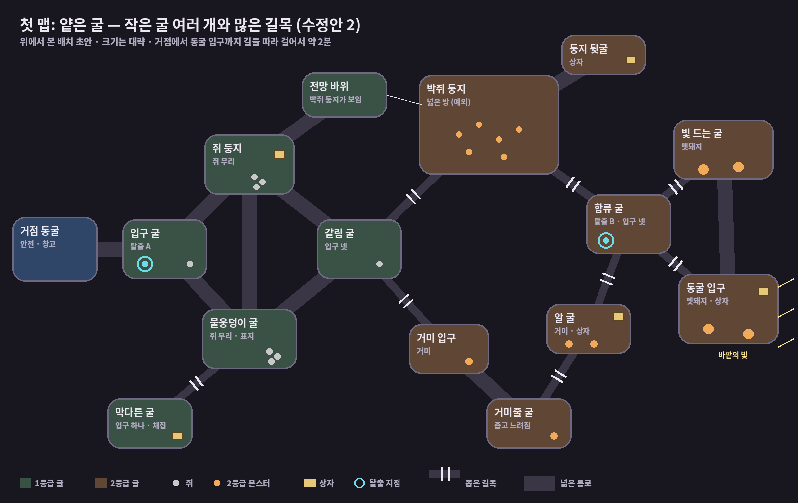

# 첫 맵: 얕은 굴 — 배치 이유

얕은 굴은 거점 동굴 바로 앞에 펼쳐진 자연 동굴이다. **작은 굴 여러 개가 좁은 길목으로 이어져 있고, 거점에서 멀어질수록 강한 몬스터가 산다.** 길을 막는 장치는 없다. 플레이어는 처음부터 어디든 갈 수 있지만, 강해지기 전에는 깊은 곳에 갈 엄두를 내지 못한다.

상태: 제안 (확정 전). 배치와 크기는 초안이며, 색 칸으로 먼저 만들어 보고 고친다.

수정 기록
- 수정안 1: 비판적 검토에서 맞다고 판단한 지적 반영. 탈출 B 위치, 구역별 머리뼈 보상 명시, 언데드 길찾기 선행 조건, 네크로맨서다운 공간, 구간별 이동 시간 측정 기준.
- 수정안 2: 큰 방 몇 개 대신 **작은 굴 여러 개와 많은 길목**으로 바꿈 (사용자 결정). 굴 14개, 좁은 길목 8곳.

---

## 0. 맵보다 먼저 해결할 것: 길찾기

지금 몬스터와 언데드는 대상을 향해 **직선으로** 움직인다. 처음 뱀서 구조에서 수백 마리를 감당하려고 일부러 길찾기를 뺐기 때문이다. 벽이 없는 시험 지역에서는 문제가 없었지만, 작은 굴과 길목이 많은 동굴에서는 이렇게 된다.

- 언데드가 모퉁이와 길목마다 벽에 걸려 네크로맨서를 따라오지 못한다.
- 몬스터가 벽 너머의 대상을 향해 벽에 붙어 버둥댄다.
- 길목, 막다른 굴처럼 이 맵이 노리는 공간이 전부 의미를 잃는다.

굴이 작고 길목이 많아질수록 이 문제는 더 커진다. 지금은 몬스터 수가 적으므로 Godot의 길찾기 기능을 써도 성능 부담이 크지 않다. **그레이박싱 전에 길찾기를 먼저 만들고, 모퉁이가 여러 번 꺾이는 시험 통로에서 언데드가 따라오는지 확인한다.**

상태 (2026-11-07): 만들었다. 규칙은 `docs/game-design.md`의 "길찾기와 벽", 시험 통로는 `regions/test_corridor.tscn`(거점의 두 번째 출구), 확인은 `tests/scenarios/scenario_pathfinding.gd`.

## 1. 이 맵이 지켜야 하는 것 (사용자가 정한 방향)

- 거점은 미궁 안의, 개척되지 않은 자연 상태 그대로의 동굴이다. 게임은 이 동굴에서 시작한다.
- 네크로맨서는 동굴 안의 무서운 몬스터를 피해 작은 몬스터를 잡으며 성장한다.
- 처음에는 동굴 앞에서 얼마 떨어지지 않은 곳까지만 탐험한다.
- **성장해서 갈 수 있는 곳이 늘어난다는 것은, 플레이어 스스로 갈 자신감과 의지가 생긴다는 뜻이다. 갈 방법을 만들어 주는 것이 아니다.**
- 쥐는 아무것도 할 수 없는 네크로맨서가 처음 잡아서 쓰는 언데드로서 상징적이어야 한다.
- 멧돼지와 다른 몬스터는 강력하진 않지만, 플레이어가 초반 상태 그대로는 잡을 수 없다는 벽을 확실하게 느껴야 한다.
- 개간지 같은 바깥 지역은 이야기가 진행되면서 갈 수 있는 곳이다.
- **방은 크게 하나보다 작게 여러 개, 길목은 많이.**

## 2. 배치 원칙

### 2-1. 거리가 곧 위험도
거점 → 쥐가 사는 굴들(1등급) → 박쥐 둥지 또는 거미 굴들(2등급) → 합류 굴 → 동굴 입구(2등급) 순으로 멀어질수록 위험해진다.
플레이어가 "어디까지 가볼까"를 정하는 기준이 곧 자신의 실력과 언데드 상태가 된다. 성장이 "갈 수 있는 거리"로 눈에 보인다.

### 2-2. 문, 열쇠, 잠금이 없다
모든 길이 처음부터 열려 있다. 2등급 굴에 처음부터 들어갈 수는 있지만, 초반 상태로 들어가면 대부분 죽는다(측정: 멧돼지 혼자 상대 시 초보 95%, 보통 30% 사망).
특정 언데드로 길을 여는 장치는 일부러 넣지 않았다. 갈 수 있게 "만들어 주는" 순간 성장이 플레이어의 자신감이 아니라 게임의 허락이 되기 때문이다.

### 2-3. 작은 굴 여러 개와 많은 길목
큰 방 하나에서는 한 번의 싸움이 길게 이어지고, 이동하는 동안 고를 것이 없다. 작은 굴이 길목으로 이어지면 이렇게 바뀐다.

- **굴마다 작은 결정이 생긴다.** 다음 굴로 들어갈지, 길목에서 기다릴지, 돌아갈지를 자주 고른다.
- **길목마다 언데드를 쓰는 판단이 생긴다.** 길목에 언데드를 세워 막을지, 네크로맨서가 먼저 지나갈지.
- **자연 동굴답게 보인다.** 크고 반듯한 방보다 작은 굴이 이어진 모양이 동굴에 가깝다.
- **조금씩 만들고 고치기 쉽다.** 그레이박싱 때 굴 하나씩 추가하고 걸어볼 수 있다.

다만 길목이 많으면 생기는 문제가 있어서, 다음 규칙으로 막는다.

| 문제 | 막는 방법 |
| --- | --- |
| 길목마다 언데드를 세워 두면 2등급이 너무 쉬워진다 | 중요한 굴(갈림 굴, 합류 굴)은 **입구를 넷** 둔다. 한 길목만 막아서는 안전하지 않다 |
| 박쥐는 흩어져 돌 공간이 필요한데 작은 굴에서는 벽에 막힌다 | **박쥐 둥지만 넓은 방으로 남긴다** (유일한 예외) |
| 비슷한 작은 굴이 이어지면 길을 잃는다 | 굴마다 **표지**를 둔다: 물웅덩이, 전망 바위, 거미 알, 바깥의 빛 |
| 쥐 굴들이 한 줄이면 쥐가 늘 같은 방향에서 온다 | 쥐가 사는 굴들은 **고리 모양**으로 이어서 여러 방향에서 오고, 물러날 길도 여러 개 둔다 |
| 모퉁이마다 언데드가 걸린다 | 0장의 길찾기를 먼저 해결한다 |

### 2-4. 벽은 싸우기 전에 먼저 보인다
**전망 바위** 굴에 서면 박쥐 둥지가 보인다. 플레이어는 싸워서 죽기 전에 "저긴 아직 무섭다"를 먼저 느낀다.
전망 바위는 장식이 아니라 실제 정보를 줘야 한다. 박쥐가 몇 마리인지 보여야 한다. 전망 바위에서 박쥐 둥지로 바로 가는 길은 없다. 보기만 하는 곳이다.

### 2-5. 깊이 들어가는 이유는 그곳의 머리뼈다
이 게임에서 깊은 곳의 가장 큰 보상은 상자가 아니라 **그곳에 사는 몬스터의 머리뼈**다. 새 머리뼈는 새 언데드, 곧 새로운 싸움 방식이다. 상자는 그 위의 덤이다.

| 굴 | 얻는 머리뼈 | 언데드로서의 역할 |
| --- | --- | --- |
| 쥐 둥지, 물웅덩이 굴 | 쥐 | 싸고 흔한 첫 전력. 길목을 막는 몸 |
| 박쥐 둥지 | 박쥐 | 적의 주의를 끄는 미끼 |
| 거미 입구, 거미줄 굴, 알 굴 | 동굴 거미 | 적을 느리게 함 |
| 빛 드는 굴, 동굴 입구 | 멧돼지 | 돌진으로 적을 밀어냄 |

거미의 역할은 아직 만들지 않은 몬스터에 대한 예정이다.

여기에 익스트랙션의 긴장이 더해진다. 깊이 갈수록 얻는 것이 많지만, 죽으면 들고 있던 것을 전부 잃는다. "얼마나 챙겼고, 지금 돌아갈까"를 계속 판단하게 된다.

### 2-6. 넘는 방법을 고른다 (갈림길)
갈림 굴에서 합류 굴로 가는 길은 두 갈래다.

| 길 | 성격 | 시험하는 것 | 얻는 것 |
| --- | --- | --- | --- |
| 박쥐 둥지 | 넓은 방 하나 | 흩어져 도는 박쥐의 동시 돌진을 구르기로 피하는 실력, 마나 관리 | 박쥐 머리뼈 |
| 거미 굴들 (입구 → 거미줄 굴 → 알 굴) | 작은 굴 셋, 길목 둘 | 느려진 상태에서 버티는 법, 길목마다 언데드를 세우는 위치 선정 | 거미 머리뼈 |

두 길은 같은 곳으로 이어지지만, **어느 길로 가느냐가 어떤 언데드를 얻느냐**와 같다. 한쪽이 쉽다고 알려져도, 다른 쪽 머리뼈가 필요하면 그 길로 가야 한다. 그래서 항상 우월한 한 가지 길이 생기기 어렵다.

### 2-7. 네크로맨서다운 공간
언데드를 데리고 다닌다는 사실이 공간에서의 판단을 바꿔야 한다. 이미 정한 규칙으로 세 종류의 공간을 만든다.

| 공간 | 어디 | 이미 정한 규칙과의 관계 | 플레이어가 하는 판단 |
| --- | --- | --- | --- |
| **길목** | 8곳 (아래 표) | 멧돼지 돌진은 대상을 지나 40px에서 멈춘다 | 언데드를 길목에 세워 돌진을 받아내고, 네크로맨서는 뒤에서 쏜다 |
| **넓은 방** | 박쥐 둥지 | 박쥐는 대상 주위에 흩어져 돌다가 동시 돌진한다 | 느린 근접 언데드는 불리하다. 조준 실력과 구르기가 중요해진다 |
| **막다른 굴** | 물웅덩이 굴 아래 | 채집은 피해를 받으면 끊긴다 | 입구 하나만 언데드가 막으면 안에서 채집할 시간을 번다 |

좁은 길목 8곳

| 길목 | 의미 |
| --- | --- |
| 물웅덩이 굴 ↔ 막다른 굴 | 막다른 굴을 지키는 입구 |
| 갈림 굴 ↔ 박쥐 둥지 | 박쥐 길의 시작 |
| 갈림 굴 ↔ 거미 입구 | 거미 길의 시작 |
| 거미줄 굴 ↔ 알 굴 | 거미 길 안의 고비 |
| 알 굴 ↔ 합류 굴 | 거미 길의 끝 |
| 박쥐 둥지 ↔ 합류 굴 | 박쥐 길의 끝 |
| 합류 굴 ↔ 빛 드는 굴 | 멧돼지 영역 입구 |
| 합류 굴 ↔ 동굴 입구 | 멧돼지 영역 입구 |

1등급 쥐 굴들 사이는 넓은 통로로 이어서, 초반에는 길목 판단 없이 편하게 움직이게 한다. 길목은 2등급에 가까워질수록 많아진다.

### 2-8. 깊이 갈수록 탈출이 편해진다
- **탈출 A**: 입구 굴, 거점 바로 앞. 안전하다.
- **탈출 B**: 합류 굴. 박쥐 길과 거미 길이 만나는 곳이고, 멧돼지 영역(빛 드는 굴, 동굴 입구)으로 들어가기 전이다.

2등급 갈림길 하나를 넘은 플레이어는 멧돼지를 상대하지 않고 B로 나갈 수 있다. 위험을 감수하고 깊이 온 보상이다. 멧돼지와 싸우는 것은 멧돼지 머리뼈와 그 영역의 상자를 원할 때만 고르는 선택이 된다. 합류 굴은 입구가 넷이라, 탈출 게이지를 채우는 3초 동안 어느 쪽에서 몬스터가 올지 경계해야 한다.

### 2-9. 다음 이야기로 이어지는 출구
동굴 입구 굴에서 바깥 숲의 빛이 새어 든다. "언젠가 저 밖으로 나간다"는 목표를 처음부터 보여준다. 이야기가 진행되면 이곳이 개간지 같은 바깥 지역으로 나가는 출구가 된다.

## 3. 굴별 정리

| 굴 | 등급 | 몬스터 | 상자 | 특징 |
| --- | --- | --- | --- | --- |
| 거점 동굴 | — | 없음 | 창고 | 출발점, 안전 |
| 입구 굴 | 1 | 쥐 1 | — | 탈출 A |
| 쥐 둥지 | 1 | 쥐 무리 | 1 | 쥐 굴 고리의 위쪽 |
| 물웅덩이 굴 | 1 | 쥐 무리 | — | 표지: 물웅덩이. 막다른 굴로 이어짐 |
| 전망 바위 | 1 | 없음 | — | 박쥐 둥지가 보임. 길은 없음 |
| 막다른 굴 | 1 | 없음 | 1 | 입구 하나. 채집하기 좋은 곳 |
| 갈림 굴 | 1 | 쥐 1 | — | 입구 넷. 박쥐 길과 거미 길이 갈림 |
| 박쥐 둥지 | 2 | 박쥐 무리 | — | 넓은 방 (유일한 예외) |
| 둥지 뒷굴 | 2 | 없음 | 1 | 박쥐 둥지를 지나야 닿음 |
| 거미 입구 | 2 | 거미 | — | 거미 길의 첫 굴 |
| 거미줄 굴 | 2 | 거미 | — | 좁고 느려짐 |
| 알 굴 | 2 | 거미 | 1 | 표지: 거미 알 |
| 합류 굴 | 2 | 없음 | — | 입구 넷. 탈출 B |
| 빛 드는 굴 | 2 | 멧돼지 | — | 멧돼지 영역 |
| 동굴 입구 | 2 | 멧돼지 | 1 | 표지: 바깥의 빛. 나중에 바깥으로 나가는 곳 |

- 박쥐와 동굴 거미는 동굴에 어울리는 몬스터라 안쪽에 둔다.
- 멧돼지는 숲 짐승이라, 바깥 숲과 이어진 동굴 입구 쪽에 둔다.
- 동굴 거미는 아직 만들지 않은 몬스터다.

## 4. 크기

- 거점에서 동굴 입구까지 **길을 따라 걸어서 약 2분**을 목표로 한다. 직접 정한 목표이며, 전투와 채집 시간은 따로 더해진다.
- 걷기 속도 초당 80픽셀(임시값) 기준으로 약 9,600픽셀, 32픽셀 타일로 약 300칸이다.
- 작은 굴과 꺾이는 길목이 시간을 채우므로, 맵 전체 면적은 큰 방 구조보다 작아도 된다.

그레이박싱에서 아래 구간별 시간을 재서, 실제 한 판이 얼마나 걸리는지 확인한다. 순수 걷기 시간이며, 기준값은 측정 출발점이다.

| 구간 | 걷기 시간 기준 |
| --- | ---: |
| 거점 → 입구 굴 | 약 10초 |
| 입구 굴 → 갈림 굴 (쥐 굴들을 지나) | 약 40초 (처음 30초, 굴을 키워 바꿈) |
| 갈림 굴 → 합류 굴 (박쥐 길 또는 거미 길) | 약 60초 (처음 50초) |
| 합류 굴 → 동굴 입구 | 약 25초 (처음 20초) |
| 합계 | 약 2분 |

굴을 키우면서(6-3) 굴 안을 걷는 시간이 탐험 시간이 되도록 구간 기준을 늘렸다 (사용자 결정, 2026-11-08). 거점 → 입구 굴과 합계는 그대로다.

## 5. 일부러 넣지 않은 것

- **특정 언데드로 여는 길, 막힌 출구, 열쇠**: 성장은 플레이어의 자신감이어야 하고, 게임이 길을 열어주는 것이 아니어야 하기 때문이다.
- **맵 해금 단계**: 같은 이유.
- **까마귀**: 바깥 지역(개간지)의 몬스터라 동굴에는 두지 않는다.

## 6. 아직 정하지 않은 것

- **몬스터가 다시 나타나는지, 나타난다면 언제.** 반복 플레이의 느낌을 가장 크게 좌우한다.
  - 임시 (2026-11-07): 맵에 들어올 때마다 몬스터가 처음 상태로 다시 놓인다 (지역 씬을 새로 불러오므로). 재등장 규칙을 정하면 바꾼다.
- 굴 14개, 길목 8곳이 적당한지 (그레이박싱에서 걸어보고 판단)
- 탈출 지점이 2개로 충분한지
- 멧돼지를 동굴 입구 쪽에 두는 것이 맞는지
- ~~게임 내부 해상도~~: 이미 640×360으로 확정되어 있다 (`docs/art-direction.md`). 한 화면에 가로 20칸, 세로 약 11칸(32px 타일)이 보인다.

## 6-1. 그레이박스 (앞쪽 절반, 2026-11-07)

- 배치 PNG: `art_src/maps/shallow_cave.png` (색 규칙 `docs/maps/map_png_rules.md`), 씬: `regions/shallow_cave.tscn`. 거점의 기본 출구(가운데 원)로 들어온다.
- 들어 있는 굴: 거점 동굴(도착 지점), 입구 굴(탈출 A, 쥐 1), 쥐 둥지(쥐 2, 상자), 물웅덩이 굴(쥐 2), 전망 바위, 막다른 굴(상자, 좁은 길목 하나), 갈림 굴(쥐 1), 쥐 둥지와 물웅덩이 굴 사이의 작은 굴(없음).
- 갈림 굴에서 박쥐 둥지·거미 입구로 가는 길목은 짧게 그린 뒤 막아 두었다 (보라색 칸). 갈림 굴의 입구 넷 중 둘이다. 뒤쪽 절반을 그리며 열었다 (6-2).
- 쥐 무리는 2마리, 따로 움직인다 (사용자 결정). 상자 내용물은 시험 상자 데이터 그대로다 (임시).
- 처음 그레이박스의 굴 크기는 한 화면(가로 20칸, 세로 약 11칸)에 들어오는 10~14칸이었다. 지금은 아래 "굴을 크게" 이후 크기다. 막다른 굴 길목은 두 칸이다.
- 통로를 휘게 다시 그렸다 (2026-11-08, 규칙은 `map_png_rules.md`의 "통로 모양"). 처음에는 굴 사이를 곧은 띠로 이어서 너무 반듯했다. 아래 값은 그때 배치의 값이다.
  - 굴 모양·물건 위치는 그대로 두고 통로만 다시 그렸다. 굴마다 입구 수·이어진 굴은 전과 같다.
  - 통로 8개 모두 2번 이상 꺾인다 (꺾이는 각 29~69°). 곧은 구간은 가장 긴 것이 7.1칸, 폭은 3.0~5.7칸 사이로 바뀐다.
  - 길목 3곳(막다른 굴 입구, 막아 둔 박쥐 둥지·거미 입구 길목)은 2칸 폭 ㄱ자다.
  - 전후 비교: `screenshots/compare_1_straight_2_bent.png` (왼쪽 전, 오른쪽 후. 위는 배치 PNG 3배, 아래는 맵 전체 스크린샷).
  - 걷기 시간 (걷기 80/초, `scenario_shallow_cave.gd`, 벽 가장자리 다듬은 뒤): 거점(도착 지점) → 입구 굴 10.9초 (곧은 통로일 때 10.8초), 입구 굴 → 갈림 굴 27.8초 (곧은 통로일 때 26.9초, 쥐 둥지를 지나는 가장 짧은 길).
- 굴을 크게, 통로를 짧게 다시 그렸다 (2026-11-08, 규칙은 `map_png_rules.md`의 "굴과 통로의 비율·배치"). 앞의 꺾은 통로는 작은 굴을 관으로 이은 연결도처럼 보였다.
  - 쥐 둥지와 물웅덩이 굴 사이에 **작은 굴**을 두었다 (사용자 결정). 가운데에 나란히 붙어 달리던 두 통로(쥐 둥지 ↔ 물웅덩이, 입구 굴 → 물웅덩이)를 서로 다른 길로 만들기 위해서다. 쥐 둥지 ↔ 작은 굴 ↔ 물웅덩이 굴로 이어지고, 작은 굴은 입구 둘, 몬스터·상자 없음. 다른 굴들의 입구 수·이어진 굴은 그대로다 (쥐 둥지와 물웅덩이 굴은 작은 굴을 거쳐 이어진다).
  - 바닥 중 굴 64% (다듬은 뒤도 64%, 앞의 꺾은 통로는 39%). 굴 크기: 물웅덩이 336칸, 쥐 둥지 303칸, 갈림 굴 279칸, 입구 굴 219칸, 막다른 굴 119칸, 전망 바위 114칸, 거점 동굴 79칸, 작은 굴 64칸.
  - 통로는 좁은 곳 3칸, 부푼 곳 약 6칸 (잰 값 5.8). 곡선과 급한 꺾임을 섞고, 위쪽(쥐 둥지)과 아래쪽(물웅덩이 굴)의 크기·위치·통로 길이를 다르게 했다.
  - 전후 비교: `screenshots/compare_2_bent_3_caves.png` (왼쪽 꺾은 통로, 오른쪽 이번). 단계별: `screenshots/1_straight_*`(곧은 통로), `2_bent_*`(꺾은 통로), `3_caves_*`(지금).
  - 걷기 시간 (같은 측정): 거점 → 입구 굴 9.2초 (기준 약 10초), 입구 굴 → 갈림 굴 31.3초 (기준 약 30초). 처음 그린 배치는 33.5초여서 갈림 굴을 서쪽으로 7칸, 위로 2칸 옮겼다 (사용자 결정).
- 굴 안에 바위·기둥을 두었다 (2026-11-08, 규칙은 `map_png_rules.md`의 "굴 안의 바위·기둥"). 굴 사이 거리는 그대로다.
  - 입구 굴 2 (2×5, 3×2), 쥐 둥지 2 (4×2, 4×3 계단 모양), 갈림 굴 2 (3×3, 2×4), 물웅덩이 굴 3 (4×3 모서리 빠짐, 5×2, 2×2), 전망 바위 1 (2×3), 막다른 굴 1 (2×2). 거점 동굴과 작은 굴은 거의 전부가 굴 중심 보호 구역이라 2칸 길을 남기고 둘 자리가 없어 비웠다.
  - 입구 굴의 2×5 바위는 거점에서 들어오는 입구 바로 앞에 있어, 거점 → 입구 굴을 위나 아래로 돌아가게 한다.
  - **제안**: 입구 굴 → 갈림 굴은 이미 기준(약 30초)보다 길어서, 그 길이 지나는 쥐 둥지·갈림 굴의 바위는 굴 사이를 잇는 길 옆에 두었다. 길을 더 돌게 하려면 기준 시간을 늘리거나 굴 사이를 좁혀야 한다.
  - 걷기 시간: 거점 → 입구 굴 9.4초 (바위 전 9.2초, 기준 약 10초), 입구 굴 → 갈림 굴 31.5초 (바위 전 31.3초).
  - 다듬은 뒤에도 바위 11개의 칸이 모두 벽으로 남는다. 바위마다 한쪽에서 언데드를 모은 뒤 바위 너머 반대쪽으로 가면, 쥐 언데드 2마리가 바위를 돌아 따라와 곁에 모인다 (멈춘 뒤 0~4프레임, `scenario_shallow_cave.gd`).
  - 전후 비교: `screenshots/compare_3_caves_4_rocks.png`, 지금: `screenshots/4_rocks_*`.
- 쥐 언데드 2마리를 데리고 이어진 두 굴 사이(통로 9개)를 모두 오가면, 굴에 닿을 때마다 2마리 모두 40px 안에 있다 (지금 배치, 멈춘 뒤 모이기까지 가장 늦은 것 3프레임, `scenario_shallow_cave.gd`).

## 6-2. 그레이박스 (뒤쪽 절반, 2026-11-08)

- 같은 PNG(`art_src/maps/shallow_cave.png`)를 오른쪽으로 넓혀(106 → 212칸) 그렸다. 갈림 굴의 막아 둔 길목 두 개를 열었다.
- 들어 있는 굴 (모두 2등급 굴 색): 박쥐 둥지(박쥐 무리 1), 둥지 뒷굴(상자), 거미 입구(거미 자리 1), 거미줄 굴(거미 자리 1), 알 굴(거미 자리 2, 상자), 합류 굴(탈출 B), 빛 드는 굴(멧돼지 2), 동굴 입구(멧돼지 2, 상자, 바깥의 빛 표지).
- 정한 것 (사용자 결정):
  - **거미 자리**: 동굴 거미가 아직 없어, PNG에 "거미 자리" 색(`a22633`)을 두고 임시로 고블린 투석병을 놓는다. 거미를 만들면 변환기의 데이터 연결만 바꾼다.
  - **박쥐 둥지의 박쥐**: 무리 하나(3마리). 확정된 박쥐 설계(무리 동시 돌진, 120도 간격)와 밸런스 측정이 3마리 기준이다.
- 굴마다 입구 수와 연결은 배치도(수정안 2)와 같다. 박쥐 둥지 3, 둥지 뒷굴 1, 거미 입구·거미줄 굴·알 굴 2, 합류 굴 4, 빛 드는 굴·동굴 입구 2 (둘은 넓은 통로로도 이어진다). 2칸 길목은 2-7절 "좁은 길목 8곳"의 통로에만 있다 (`scenario_shallow_cave.gd`가 확인).
- 전망 바위: 박쥐 둥지 쪽으로 3×3 바위턱을 붙였다 (전망 바위의 일부). 전망 자리(바위턱 끝)에 서면 박쥐 3마리가 모두 화면 안에 보이고, 사이는 벽 3칸이라 바로 갈 수 없다 (곧은 거리 4칸, 걸어서 130걸음). 바위턱 때문에 전망 바위 가운데가 옮겨져 전망 바위의 바위를 서쪽으로 옮겼다.
  - 박쥐는 처음에 둥지 서쪽 위에 두었더니, 박쥐 감지 거리(110px)가 짧아 갈림 굴 → 합류 굴로 지나가도 한 번도 걸리지 않았다 (측정 봇). 둥지 입구 바로 안쪽으로 옮기고, 그래도 보이게 바위턱을 붙였다.
- 박쥐 둥지는 유일한 넓은 방이다: 다듬은 뒤 박쥐가 도는 반경 최대(75) + 몸(7)px 원이 벽에 닿지 않는 자리 120칸, 가장 큰 원 반지름 6.7칸. 다음으로 넓은 동굴 입구는 83칸·5.5칸. 바위는 가장자리에 2×2 하나뿐이다.
- 멧돼지 굴: 빛 드는 굴은 길고 곧은 홀(바위는 서쪽 끝에 하나)로, 동굴 입구는 가운데 가로 길을 비우고 바위를 가장자리에 두었다. 3칸 폭 곧은 길이 24칸·20칸으로 돌진(170 + 40px = 6.6칸)보다 길다.
- 합류 굴은 멧돼지 영역 앞이다. 멧돼지만 남기고 갈림 굴에서 박쥐 길·거미 길로 각각 탈출 B까지 가면, 어느 멧돼지도 대상을 정하지 않은 채 거점에 돌아간다.
- 바닥 중 굴 64% (다듬은 뒤도 64%). 뒤쪽 굴의 바위: 박쥐 둥지 1, 합류 굴 2, 거미 입구 1, 거미줄 굴 1, 빛 드는 굴 1, 동굴 입구 2. 둥지 뒷굴과 알 굴은 작아서(77칸, 144칸) 굴 중심을 피하면서 2칸 길을 남길 자리가 없어 비웠다.
- 걷기 시간 (`scenario_shallow_cave.gd`, 굴 가운데를 지나며):

| 구간 | 걷기 시간 | 기준 |
| --- | ---: | ---: |
| 거점 → 입구 굴 | 9.4초 | 약 10초 |
| 입구 굴 → 갈림 굴 | 31.5초 | 약 30초 |
| 갈림 굴 → 합류 굴 (박쥐 길 / 거미 길) | 43.7초 / 47.9초 | 약 50초 |
| 합류 굴 → 동굴 입구 | 16.9초 | 약 20초 |
| 거점 → 동굴 입구 전체 (가장 짧은 길) | 93.2초 | 약 2분 |

- 멧돼지는 굴마다 2마리를 서로 멀리 떨어뜨려 한 마리씩 걸리게 두었다 (사용자 결정). 처음처럼 가까이 두면 한 굴에서 2마리가 함께 걸려, 쥐 언데드 2마리와 함께여도 보통 실력이 5판 모두 죽었다. 빛 드는 굴은 홀의 양 끝, 동굴 입구는 남서·북동 구석이다.
- 측정 봇 (`tests/balance/run_map_route.gd`, 실력마다 5판, 걸려 온 몬스터만 상대하고 나머지는 걸어서 지나감). 칸마다 죽은 비율 / 받은 피해 평균:

| 길 | 조건 | 숙련 | 보통 | 초보 |
| --- | --- | --- | --- | --- |
| 박쥐 길 (갈림 굴 → 박쥐 둥지 → 합류 굴) | 혼자 | 0% / 0.6 | 0% / 0.9 | 20% / 2.6 |
| | 쥐 언데드 2 | 0% / 1.2 | 0% / 0.0 | 0% / 0.6 |
| 멧돼지 쪽 지나가기 (합류 굴 → 빛 드는 굴 → 동굴 입구) | 혼자 | 0% / 0.0 | 0% / 0.6 | 0% / 1.8 |
| | 쥐 언데드 2 | 0% / 0.6 | 20% / 2.0 | 20% / 2.0 |
| 멧돼지 잡으러 (합류 굴에서 가까운 멧돼지부터 4마리) | 혼자 | 0% / 4.2 | 60% / 8.4 | 100% |
| | 쥐 언데드 2 | 0% / 4.8 | 0% / 5.4 | 80% / 9.2 |

  - 박쥐 길은 박쥐를 다 잡지 않고 빠져나가는 판이 많다 (잡은 수 평균 0.2~1.2 / 3).
  - 멧돼지 쪽은 굴 가운데를 지나가면 멧돼지를 거의 피한다 (잡은 수 0.4~0.8 / 4). 멧돼지와 싸우는 것은 머리뼈·상자를 원할 때 고르는 선택이라는 2-8절과 맞는다.
  - 멧돼지를 잡으러 가면(4마리를 체력 회복 없이 연달아) 보통 실력이 혼자 60% 죽고, 쥐 언데드 2마리와 함께면 0%다 (언데드 2마리는 판마다 모두 죽는다). 2등급 "혼자도 잡을 수 있지만 위험, 언데드는 안전을 위해"에 가깝다.
  - 봇은 싸우는 동안 길찾기를 하지 않아 벽에 막히는 경우가 있다. 실제 플레이보다 나쁘게 나올 수 있다.
- 거점 → 동굴 입구 전체(가장 짧은 길 93초)는 목표 "약 2분"보다 짧지만, 구간 기준(10·30·50·20초, 합 110초)이 거의 맞으므로 그대로 둔다 (사용자 결정). 가장 짧은 길은 굴 가운데를 지나지 않아 구간 합(약 101초)보다 짧다. 실제 한 판은 싸움·채집 시간이 더해진다.
- 전후 그림: `screenshots/5_back_half_compare.png` (위 배치 PNG, 아래 맵 전체), 전망 바위: `screenshots/5_view_rock.png`.

## 6-3. 굴 키우기 (2026-11-08)

목표: 굴 전체가 한 화면(가로 20칸, 세로 약 11칸)에 안 보여서, 걸어가 봐야 무엇이 있는지 아는 탐험하는 느낌 (사용자 결정). PNG를 확대하지 않고 굴만 키워 맵 전체를 다시 그렸다. 연결 관계·통로 길이·길목 위치는 그대로다 (박쥐 둥지 → 합류 굴 통로는 더 짧아졌다).

- 크기 (굴 바닥을 감싸는 사각형, 가로×세로 칸):

| 분류 | 굴 | 전 | 후 |
| --- | --- | --- | --- |
| 주요 | 쥐 둥지 / 갈림 굴 / 물웅덩이 굴 | 24×18 / 17×21 / 29×16 | 37×22 / 31×23 / 33×20 |
| 주요 (갈색) | 박쥐 둥지 / 합류 굴 / 빛 드는 굴 / 동굴 입구 | 25×19 / 19×16 / 32×11 / 23×20 | 43×25 / 35×20 / 36×17 / 39×25 |
| 중간 | 입구 굴 / 거미 입구 / 알 굴 / 거미줄 굴 | 18×15 / 13×12 / 15×14 / 21×9 | 21×18 / 22×15 / 22×18 / 25×11 |
| 그대로 | 거점 동굴, 작은 굴, 막다른 굴, 둥지 뒷굴 | | 같음. 전망 바위는 바위턱이 붙어 20×17 |

- 맵 212×101 → 240×116칸. 바닥 중 굴 79% (규칙을 70~80%로 바꿈, 사용자 결정).
- 안쪽 구조: 큰 굴마다 움푹 들어간 곳(곁굴)과 바위·기둥, 시야를 가리는 긴 바위를 두었다. 몬스터는 보이는 대상만 감지하므로 바위 뒤로 숨거나 돌아갈 수 있다. 시야를 가리는 벽은 다듬기가 깎지 않도록 바위(섬)로 그렸다.
  - 쥐 둥지: 북서쪽 곁굴에 상자, 서쪽 기둥 둘, 동쪽에 세로로 긴 바위(2×9)가 갈림 굴 쪽에서 오는 시야를 가리고 그 뒤에 쥐 둘, 남동쪽 곁굴.
  - 물웅덩이 굴: 북쪽 긴 바위(6×2) 아래에 쥐가 숨어 작은 굴에서 내려오면 바로 안 보인다. 남서쪽 곁굴.
  - 합류 굴: 탈출 B를 기둥 동쪽에 두었다. 박쥐 둥지는 가운데를 비우고 가장자리에만 기둥.
  - 빛 드는 굴: 가운데 곧은 홀(33칸)을 비우고 위아래 가장자리에 기둥, 동쪽 기둥 뒤에 새 상자. 동굴 입구: 남서쪽 곁굴에 멧돼지 하나가 숨어 있다.
- 몬스터·상자: 쥐 6 → 10 (쥐 둥지 4, 물웅덩이 굴 3, 갈림 굴 2, 입구 굴 1), 상자 5 → 6 (빛 드는 굴에 하나). 박쥐 무리 1, 멧돼지 2+2, 거미 자리 1·1·2는 그대로.
- 박쥐: 둥지가 커져 박쥐를 곁굴 안쪽에 두고, 갈림 굴에서 오는 입구를 곁굴 남서쪽으로 옮겨 들어와 둥지 가운데로 가는 길이 박쥐 곁(약 3칸)을 지나게 했다. 전망 자리에서 3마리 모두 보인다.
- 걷기 시간 (`scenario_shallow_cave.gd`): 도착 지점 → 입구 굴 11.1초 (기준 약 10초), 입구 굴 → 갈림 굴 37.4초 (약 40초), 갈림 굴 → 합류 굴 박쥐 길 44.6초 · 거미 길 50.3초 (약 60초), 합류 굴 → 동굴 입구 20.1초 (약 25초), 거점 → 동굴 입구 가장 짧은 길 104.1초 (약 2분). 박쥐 둥지 → 합류 굴 통로를 짧게 그려 갈림 굴 → 합류 굴이 예상(약 56~61초)보다 짧다.
- 굴마다 걷기 시간 (몬스터 없음, 실제 길찾기로 걸음):

| 굴 | 도착 지점에서 | 가장 가까운 탈출 지점까지 |
| --- | ---: | --- |
| 거점 동굴 | 0.6초 | 8.7초 (A) |
| 입구 굴 | 11.1초 | 1.6초 (A) |
| 쥐 둥지 | 26.3초 | 19.1초 (A) |
| 물웅덩이 굴 | 26.7초 | 17.6초 (A) |
| 막다른 굴 | 31.7초 | 22.7초 (A) |
| 작은 굴 | 33.4초 | 26.2초 (A) |
| 전망 바위 | 40.0초 | 32.9초 (A) |
| 갈림 굴 | 45.5초 | **37.5초 (A)**, 탈출 지점에서 가장 멀다 |
| 거미 입구 | 56.8초 | 35.2초 (B) |
| 박쥐 둥지 | 61.8초 | 26.4초 (B) |
| 거미줄 굴 | 68.4초 | 24.3초 (B) |
| 둥지 뒷굴 | 75.8초 | 29.5초 (B) |
| 알 굴 | 79.8초 | 13.3초 (B) |
| 합류 굴 | 83.5초 | 3.2초 (B) |
| 빛 드는 굴 | 101.5초 | 17.7초 (B) |
| 동굴 입구 | **104.1초**, 도착 지점에서 가장 멀다 | 16.6초 (B) |

- 길찾기 격자 (몸 크기마다 처음 쓸 때 만든다): 크기마다 약 320~360ms, 네 크기 합계 약 1.35초 (전 1.1초). 맵 넓이(벽 포함)에 비례한다.
- 그림: `screenshots/6_big_rooms_compare.png` (위 배치 PNG, 아래 맵 전체), 전망 바위: `screenshots/6_view_rock.png`.

## 7. 다음 단계

1. 몬스터와 언데드의 길찾기를 만들고, 모퉁이가 여러 번 꺾이는 시험 통로에서 확인한다.
2. 위 미정 항목을 정한다.
3. 그림 없이 색 칸만으로 맵을 만든다 (그레이박싱). 거점과 쥐 굴들부터 만들고 걸어본 뒤, 2등급 굴을 하나씩 붙인다.
4. 직접 걸어보며 확인한다.
   - 구간별 걷기 시간
   - 굴마다 표지가 있어서 길을 잃지 않는지
   - 전망 바위에서 박쥐 수가 실제로 보이는지
   - 길목에서 쥐 언데드가 멧돼지 돌진을 받아내는지
   - 갈림 굴과 합류 굴에서 한 길목만 막아서는 안전하지 않은지
   - 막다른 굴에서 언데드가 입구를 막는 동안 채집이 되는지
   - 갈림길을 넘은 뒤 탈출 B까지 멧돼지와 마주치지 않고 갈 수 있는지
5. 배치를 고친 뒤에 타일 그림을 입힌다.
